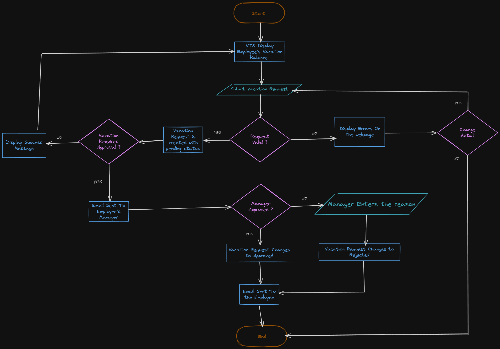
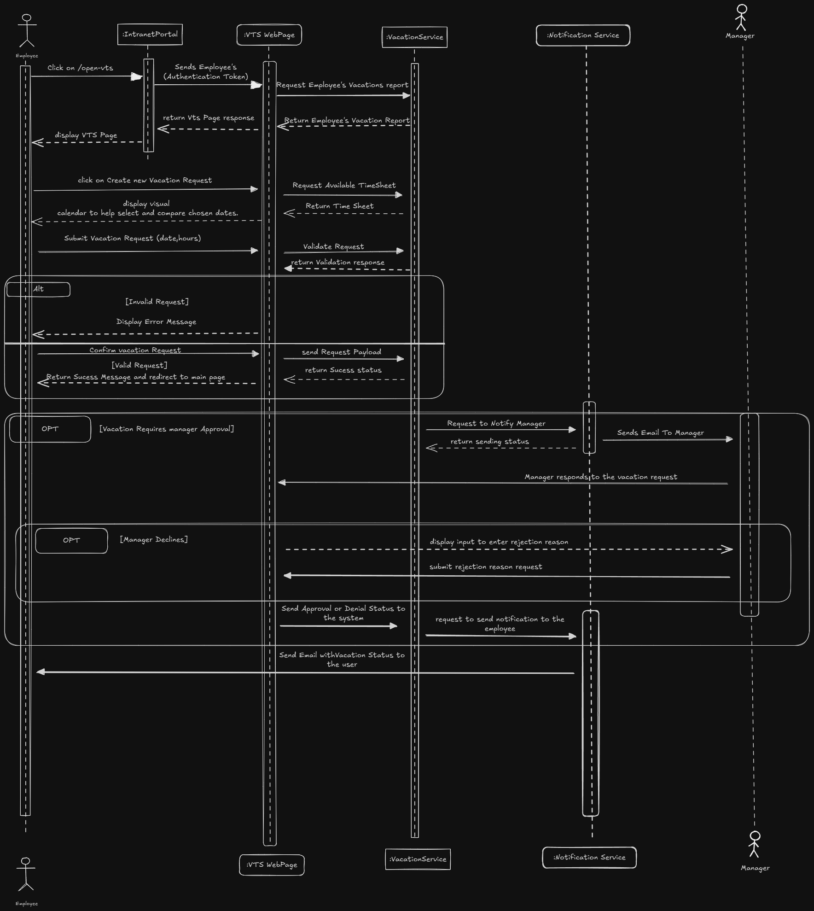
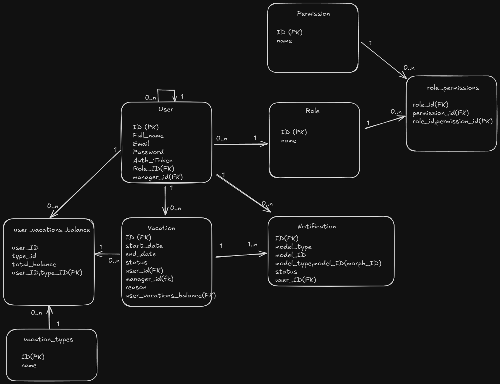

# Mentorship Task — Software Analysis

## 1. Project Information

| Item | Details |
|---|---|
| Project Name | Vacation Tracking System (VTS) |
| Student Name | Mostafa Shaher |

## 2. Vision

To provide a Vacation Tracking System that helps employees manage their vacation requests and helps managers review them, reducing errors caused by manual vacation-request handling.

## 3. Actors

- Employee
- Manager

## 4. Functional Requirements

| ID | Requirement | Related Actor |
|---|---|---|
| FR-01 | `The system shall allow users to view Vacations Report` | `Employee or Manager` |
| FR-02 | `The system shall allow users to Submit Vacation Request` | `Employee or Manager` |
| FR-03 | `The system shall allow managers to view employee's vacation request` | `Manager` |
| FR-04 | `The system shall let managers take action on employee's vacation request` | `Manager`|
| FR-05 | `Manager shall be Notified when an Employee they manage request a vacation ` | `Manager`|
| FR-06 | `Employee shall be Notified when their manager approve or deny their vacation request` | `Employee`|

## 5. Non-Functional Requirements

| ID | Category | Requirement |
|---|---|---|
| NFR-01 | `Security` | `Users shall be authenticated using SSO` |
| NFR-02 | `Performance` | `The 95th percentile response time for submitting vacation requests shall not exceed 1000 ms.` |
| NFR-03 | `Security` | `Only authorized manager shall approve or reject the vacation request` |
| NFR-04 | `Consistency` | `The system shall ensure data consistency when multiple vacation requests are submitted concurrently` |

## 6. Use Case Diagram

[Open the editable Use Case Diagram](Diagrams/UseCase.excalidraw)

## 7. Sequence Diagram

[Open the editable Sequence Diagram](Diagrams/SequenceDiagram.excalidraw)

## 8. Data Model

[Open the editable Data Diagram](Diagrams/DataDiagram.excalidraw)

## 9. Pseudocode

[Open the pseudocode file](Diagrams/PeseudoCode.txt)
