# Mentorship Task 2 — Software Design

[Back to Repository Overview](../README.md) · [Task 1 — Software Analysis](../task1/task_readme.md)

## 1. Project Information

| Item | Details |
|---|---|
| Project Name | Vacation Tracking System (VTS) |
| Student Name | Mostafa Shaher |
| Focus | Vacation request workflows, request states, dynamic approval data model, and UI wireframes |

## 2. Overview

This task extends the Vacation Tracking System analysis from Task 1 with designs for editing pending requests, canceling approved requests, and withdrawing pending requests. It also includes a request state diagram, a data model for configurable approval hierarchies, and UI wireframes for employees and managers.

## 3. Task Structure

| Folder | Contents |
|---|---|
| [edit-pending-request](edit-pending-request/) | Sequence diagram, flow chart, editable sources, and pseudocode |
| [cancel-approved-request](cancel-approved-request/) | Sequence diagram, flow chart, editable sources, and pseudocode |
| [withdraw-request](withdraw-request/) | Sequence diagram, flow chart, editable sources, and pseudocode |
| [state-diagram](state-diagram/) | Request state diagram and editable source |
| [data-model-to-make-acceptance-dynamic](data-model-to-make-acceptance-dynamic/) | Dynamic approval data model and editable source |
| [UI](UI/) | Vacation list, create request, and manager verdict wireframes with editable sources |

## 4. Edit Pending Request

Employees can edit a pending request's title, comments, and dates, then save valid changes. They can also choose to withdraw the request after confirmation.

### Sequence Diagram

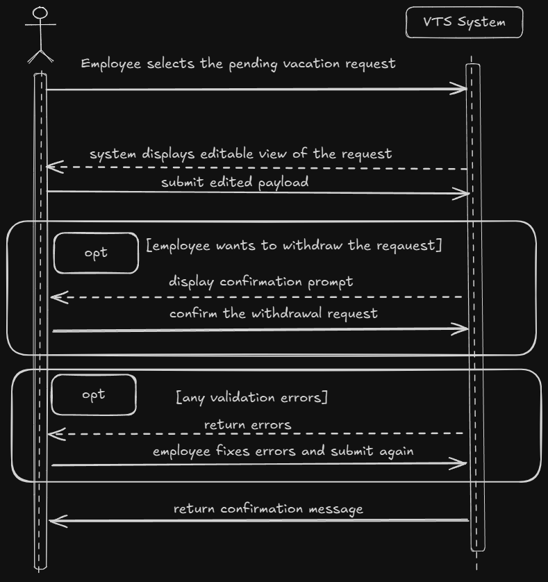

[Open the editable Sequence Diagram](edit-pending-request/sequence_diagram.excalidraw)

### Flow Chart

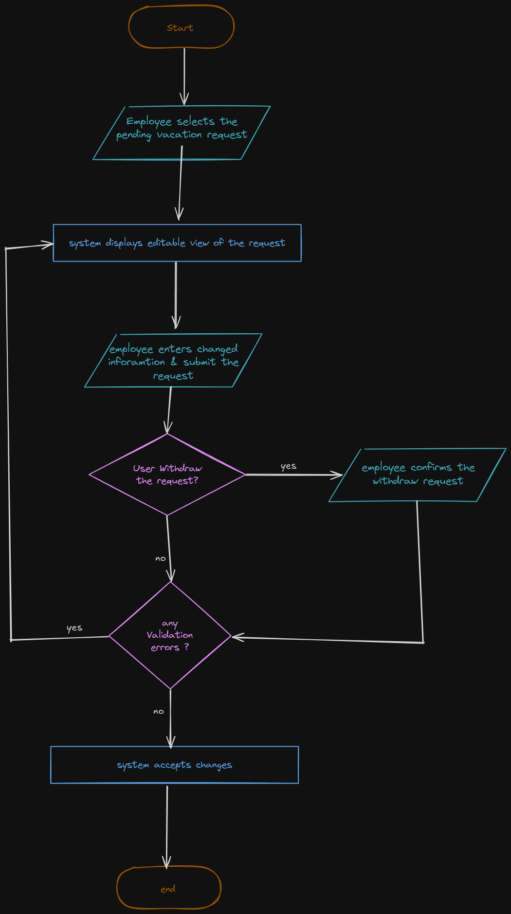

[Open the editable Flow Chart](edit-pending-request/flow_chart.excalidraw)

### Pseudocode

[Open the pseudocode file](edit-pending-request/pseudocode.txt)

## 5. Cancel Approved Request

Employees can cancel an eligible approved request after confirmation. The pseudocode permits future requests or requests within the last five business days, and requires an explanation for past dates. Cancellation updates the request status, returns vacation days to the employee's balance, and notifies the manager by email.

### Sequence Diagram

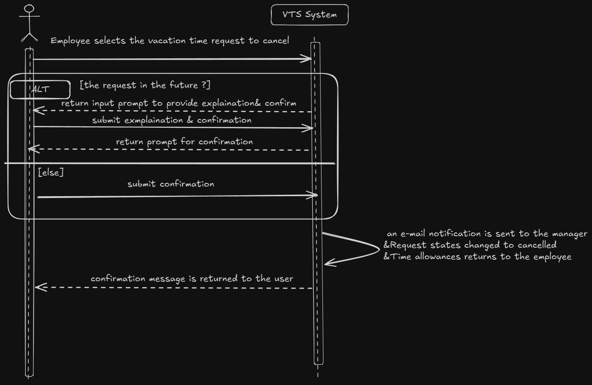

[Open the editable Sequence Diagram](cancel-approved-request/sequence_diagram.excalidraw)

### Flow Chart

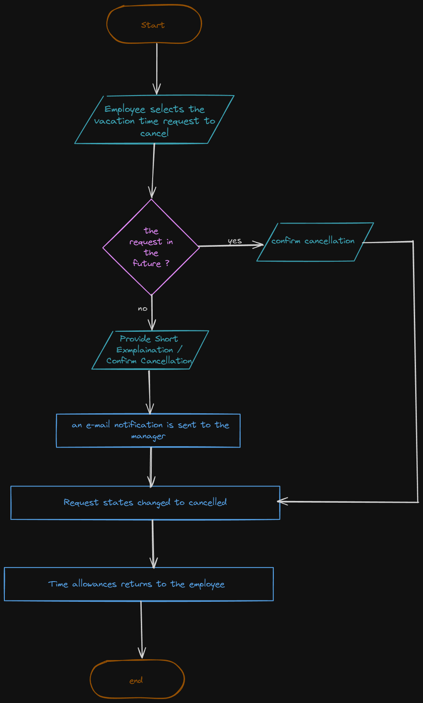

[Open the editable Flow Chart](cancel-approved-request/flow_chart.excalidraw)

### Pseudocode

[Open the pseudocode file](cancel-approved-request/pseudocode.txt)

## 6. Withdraw Pending Request

Employees can withdraw a pending request after confirmation. The workflow removes the request from the manager's pending list, notifies the manager by email, and changes the request status to withdrawn.

### Sequence Diagram

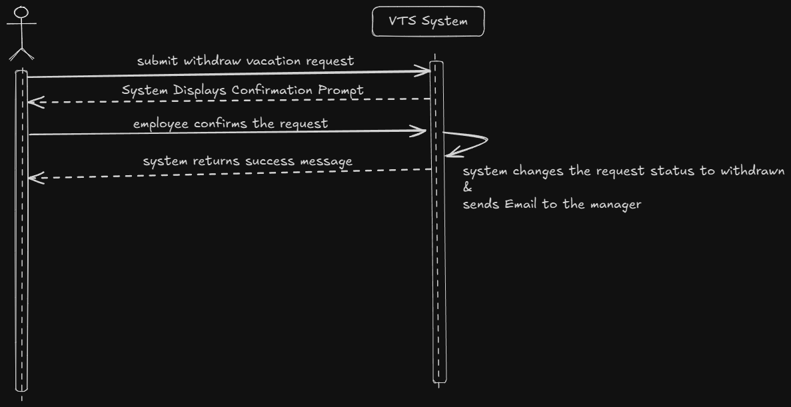

[Open the editable Sequence Diagram](withdraw-request/sequence_diagram.excalidraw)

### Flow Chart

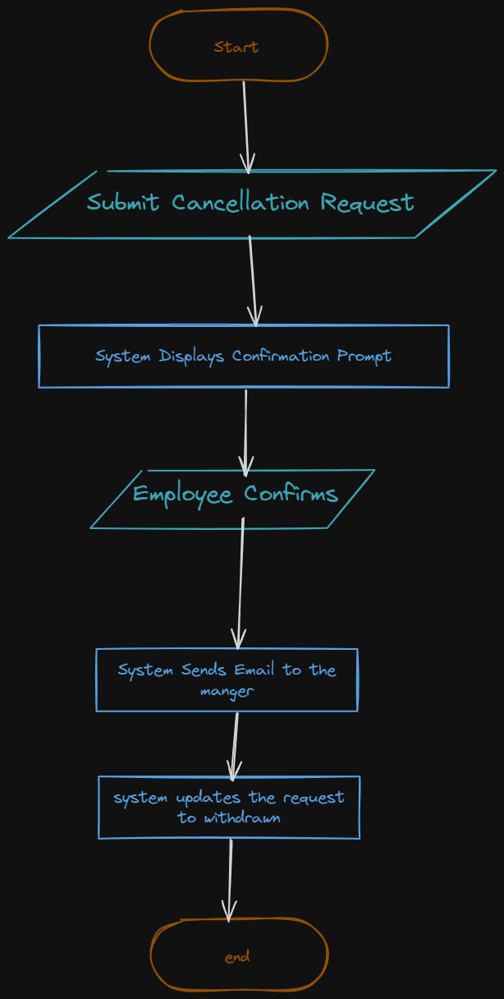

[Open the editable Flow Chart](withdraw-request/flow_chart.excalidraw)

### Pseudocode

[Open the pseudocode file](withdraw-request/pseudocode.txt)

## 7. Request State Diagram

The state diagram shows the request lifecycle, including draft, pending, approved, rejected, withdrawn, and cancelled states.

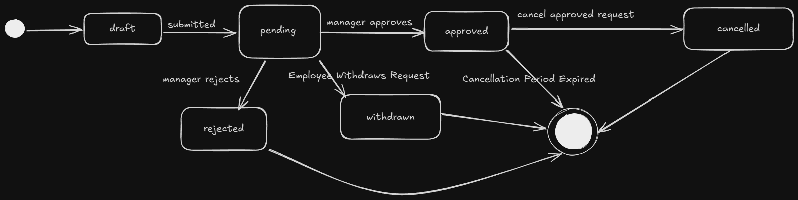

[Open the editable State Diagram](state-diagram/state_diagram.excalidraw)

## 8. Dynamic Approval Data Model

The data model includes vacation types, employee vacation balances, approval hierarchy priorities, authorized approvers, and approval history.

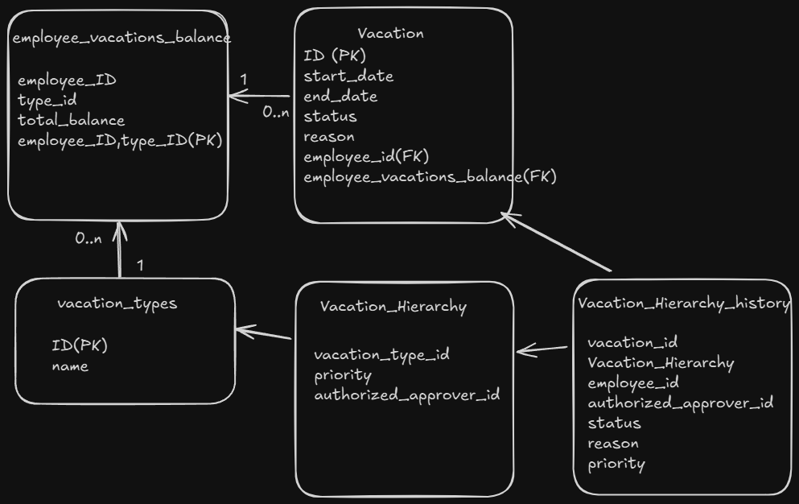

[Open the editable Data Diagram](data-model-to-make-acceptance-dynamic/DataDiagram.excalidraw)

## 9. UI Wireframes

### Vacation Requests List

The employee portal shows vacation requests with their dates, types, statuses, reasons, and actions, along with date search, a status filter, and a create request action.

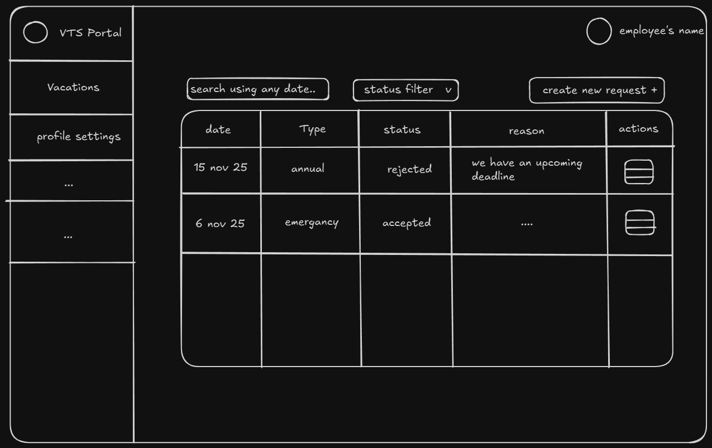

[Open the editable Vacation Requests List Wireframe](UI/index.excalidraw)

### Create Vacation Request

The create request screen includes title, description, and date inputs, with submit and cancel actions.

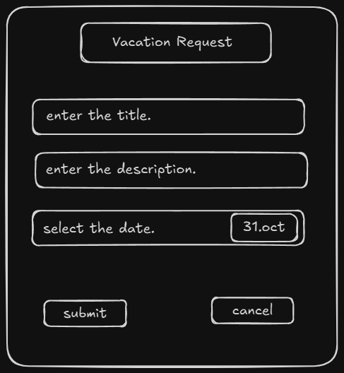

[Open the editable Create Vacation Request Wireframe](UI/create.excalidraw)

### Manager Verdict

The manager screen displays employee and request details, with approve and deny actions and a denial reason dialog.

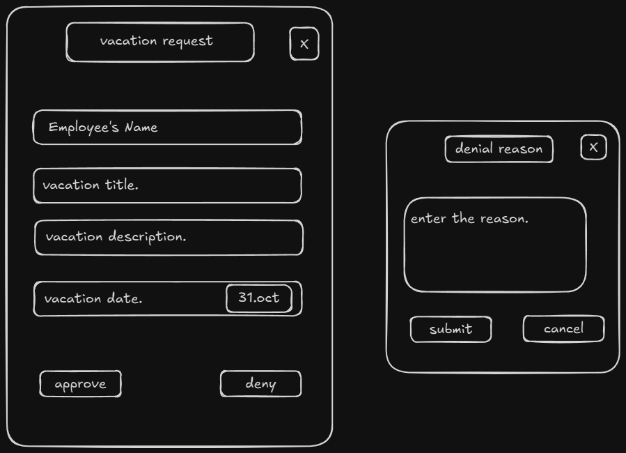

[Open the editable Manager Verdict Wireframe](UI/manager_verdict.excalidraw)
